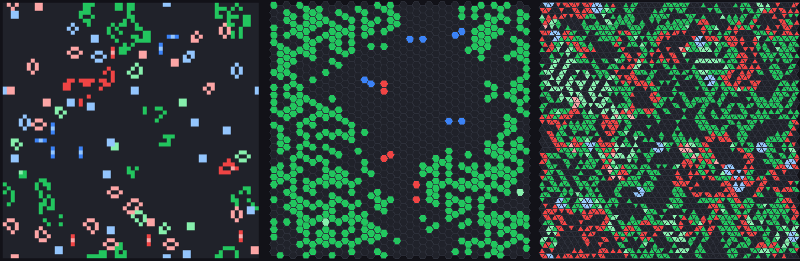
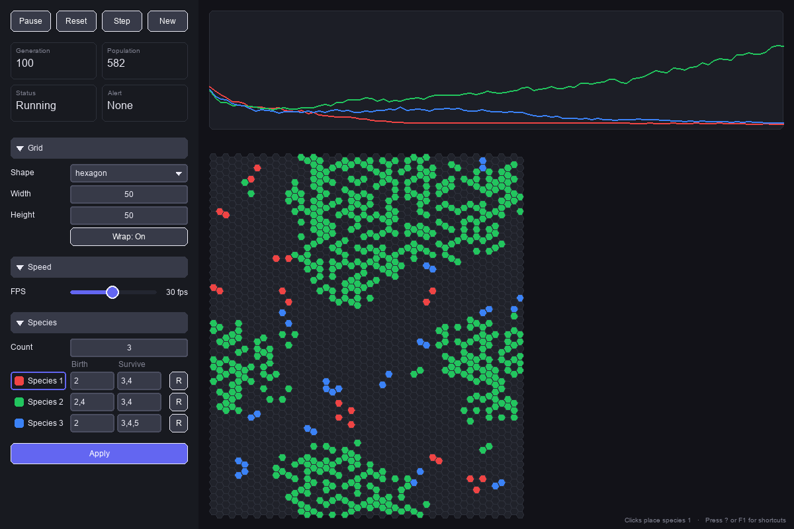
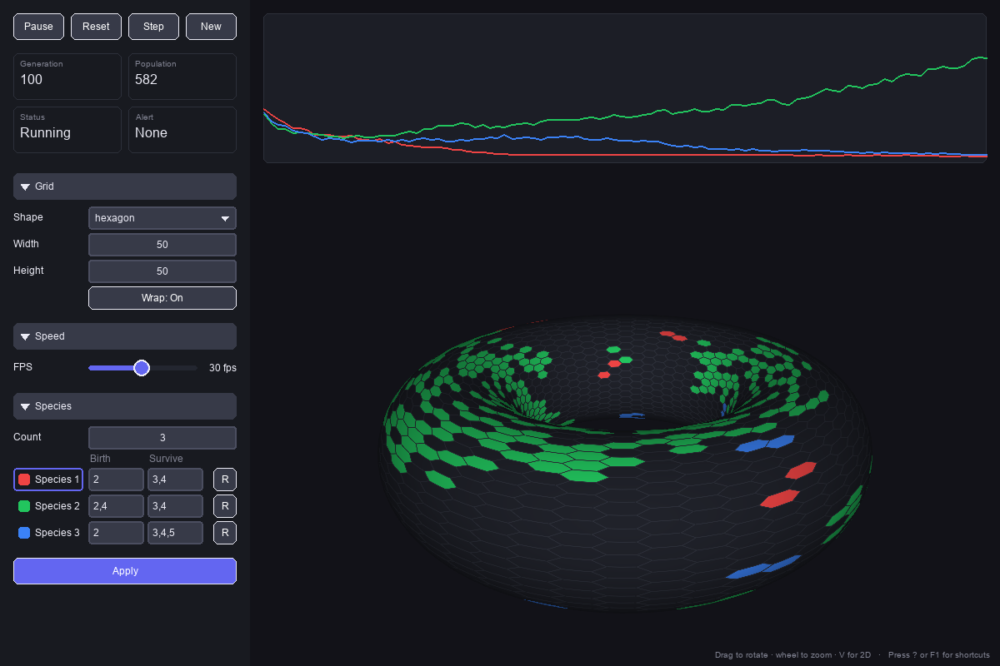
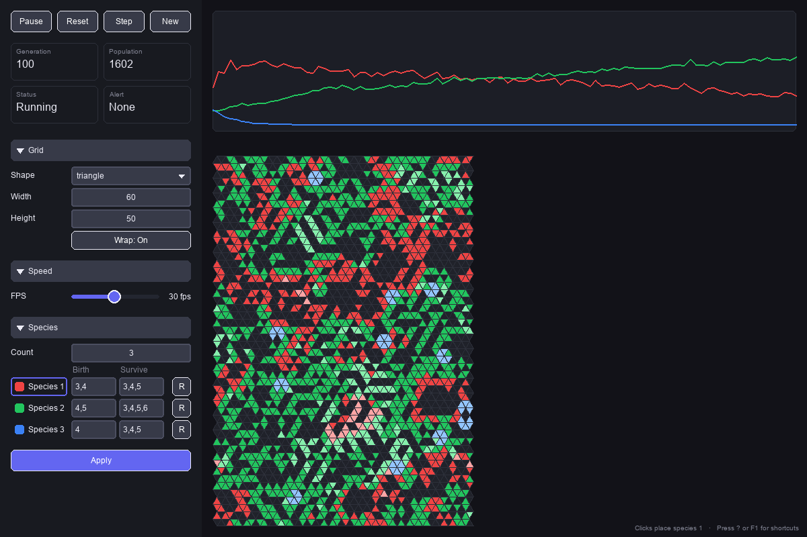
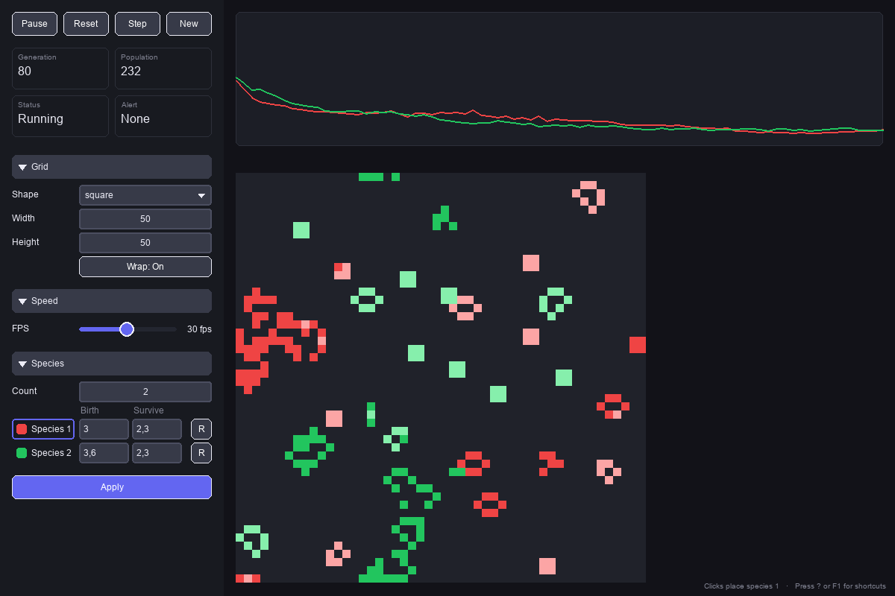
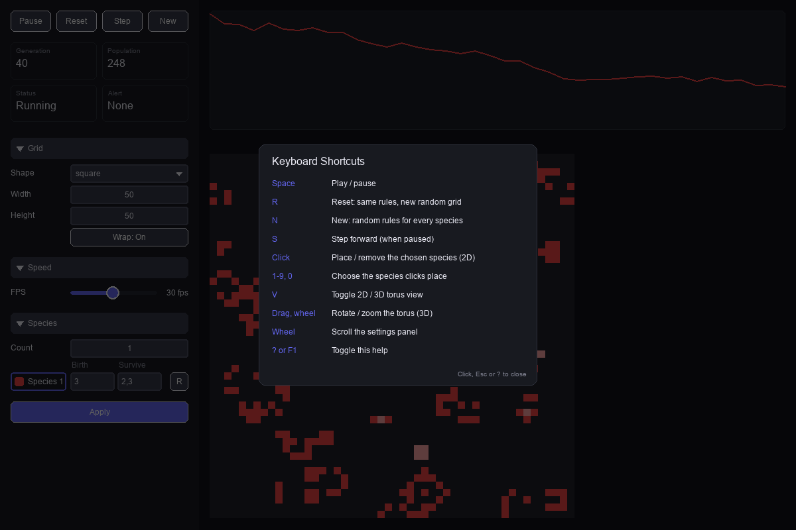
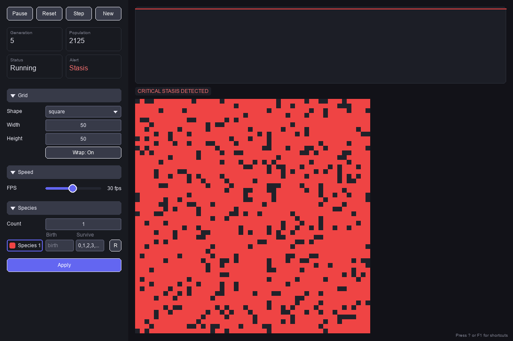

# LatticeLife

A lattice cellular automaton research platform. Supersedes `gameoflife_advanced`.



**Design thesis:** geometry is data. There is exactly one update rule in this codebase; a
lattice geometry is expressed purely as an adjacency structure handed to that rule. See
`docs/LOCAL_RULE_DETERMINISM_POSITION_PAPER.md` for the motivating argument.

See `latticelife_rebuild_spec_v1.0.md` (in the legacy repo) for the full rebuild specification.

**Findings so far.** Experiments run on LatticeLife have produced exact period laws for its parity
rules, and proofs of several of them. They have also produced a registered atlas of 42 linear rules
across the three lattices, now being extended to rules nobody has computed, and a logarithmic
settling-time law with universal fluctuations. Each was tested by predictions written down before
the runs. See [What has been found with it](#what-has-been-found-with-it).

## What it does

- **Three lattices, one rule.** Square grids with 8 neighbours, hexagon grids with 6, and
  triangle grids with 3 (edge) or 12 (edge+vertex), wrapped into a torus or bounded. A shape is
  an adjacency array (`docs/adjacency.md`); the update rule never knows which one it was given.
- **Up to ten species** on one grid, each with its own outer-totalistic `B/S` rule, competing
  for cells.
- **An interactive app** with live editing by clicking, a population chart per species, alerts
  for a sudden population crash and for stasis, and a 3D view of the wrapped grid on its torus.
- **Headless instruments.** `autorun` records every generation of batches of sessions to
  SQLite, `discover` runs a (mu+lambda) search for rules near criticality, and `census`,
  `sweep`, `soup` and `damage` give exact periods, phase diagrams, object catalogues and damage
  spreading per lattice. `observe` turns their records into numbers with intervals, and says
  when a number is only a bound.
- **A stable library interface.** Other projects drive the experiments from Python, as the
  law-discovery loop [lattice-lab](https://github.com/tripptytrip/lattice-lab) does: sessions,
  sweeps, census, damage, and observables. The observables cover settling times, survival, event
  times (exact or censored), whole damage curves per seed, object sizes, counts over time, and
  local transients (when each block of the torus enters the soup's final cycle).
  The names are pinned by tests, and any change to them is noted in `docs/CHANGELOG.md`.

## Screenshots

<table>
  <tr>
    <td width="50%">
      
      <br><sub>Three species on a wrapped 50 x 50 hexagon grid, each with its own <code>B/S</code> rule. The chart tracks every species' population.</sub>
    </td>
    <td width="50%">
      
      <br><sub>The same grid on its torus (<code>V</code>): drag to rotate, wheel to zoom. Needs the <code>[torus]</code> extra.</sub>
    </td>
  </tr>
  <tr>
    <td>
      
      <br><sub>A 60 x 50 triangle grid in edge+vertex mode, where every cell has 12 neighbours.</sub>
    </td>
    <td>
      
      <br><sub>Conway's Life (<code>B3/S23</code>) against HighLife (<code>B36/S23</code>) on a square grid. Lighter cells have been alive longer than the static threshold.</sub>
    </td>
  </tr>
  <tr>
    <td>
      
      <br><sub>The shortcuts overlay (<code>?</code> or <code>F1</code>).</sub>
    </td>
    <td>
      
      <br><sub>The stasis alert: over 80% of the grid occupied and almost nothing changing. A population crash raises a sudden-death alert and pauses the run.</sub>
    </td>
  </tr>
</table>

Every image is rendered by `scripts/screenshots.py` without a display, from seeded runs, so
`uv run python scripts/screenshots.py` re-renders them after a change to the app.

## Usage

```bash
uv run python -m latticelife.cli ui                                    # interactive pygame app
uv run python -m latticelife.cli autorun --sessions 10 --generations 200 --shape random
uv run python -m latticelife.cli discover --minutes 30                 # (mu+lambda) rule search
uv run python -m latticelife.cli census --shape hexagon --rules dual   # every rule's exact fate
uv run python -m latticelife.cli sweep --shape hexagon --rule B2/S34 --grid 16 32 64
uv run python -m latticelife.cli soup --shape hexagon --rule B2/S34    # objects soups leave
uv run python -m latticelife.cli damage --shape hexagon --rule B2/S34  # damage spreading
uv run python -m latticelife.cli observe transient out/sweep-hexagon-B2S34.jsonl
```

`census`, `sweep`, `soup` and `damage` are the mathematics experiments: exact periods, phase
diagrams, object catalogues and damage spreading per lattice, on square or rectangular tori
(`--grid 24x26`), written as JSONL and resumable. `observe` turns their records into numbers with
intervals and says when a number is only a bound. It reports settling time, survival, damage,
the time to a first repeat or to extinction (exact or a bound), every seed's damage curve, and
object sizes. See `docs/experiments.md`; the interface other projects use is kept stable and
changes are noted in `docs/CHANGELOG.md`.

3D torus rendering (the `V` key in `ui`) needs the optional extra: `uv sync --extra torus`.

Requires Python 3.12 or 3.13: the locked pygame and moderngl releases ship wheels for those only.

## What has been found with it

[lattice-lab](https://github.com/tripptytrip/lattice-lab) runs LatticeLife experiments, fits
laws to them with [Kepler](https://github.com/tripptytrip/kepler), and registers each law's
predictions before the runs that test them. Each prediction goes in a hash-chained ledger that is
committed and pushed first, so the order can be checked: `uv run lattice-lab verify --lab
<study>` in lattice-lab.

| Finding | Status | Write-up |
| --- | --- | --- |
| Period of the square parity rule, B1357/S1357 | confirmed in advance at every n up to 200; proved for odd parts up to 999 except ten | [xor-periods.md](https://github.com/tripptytrip/lattice-lab/blob/ccr-ab9f0bb1-qb20sx/docs/xor-periods.md) |
| Period of the hexagon parity rule, B135/S135 | the first law was refuted at 3 sizes; the corrected law was confirmed at 100 and **proved for every even n** | [parity-lattices.md](https://github.com/tripptytrip/lattice-lab/blob/ccr-ab9f0bb1-qb20sx/docs/parity-lattices.md) |
| Periods of the triangle parity rules | confirmed at 154 sizes; the factor 2 * 2^v(n) is proved; the odd part is checked by machine for odd parts up to 999 except ten | [parity-lattices.md](https://github.com/tripptytrip/lattice-lab/blob/ccr-ab9f0bb1-qb20sx/docs/parity-lattices.md) |
| Periods of 42 linear rules built from neighbour shells, 38 never studied | Kepler's laws confirmed blind at 1,930 (rule, size) pairs, then at 624 harder ones up to n = 400 | [linear-atlas.md](https://github.com/tripptytrip/lattice-lab/blob/ccr-ab9f0bb1-qb20sx/docs/linear-atlas.md) |
| "A rule that factors into 1D passes has a 1D period; any other reaches the full bound" | registered and **refuted**: 7 of 113 predictions failed. The failures showed two more mechanisms, perfect cubes and dilations, then predicted exactly | [linear-atlas.md](https://github.com/tripptytrip/lattice-lab/blob/ccr-ab9f0bb1-qb20sx/docs/linear-atlas.md) |
| The refined statement, on 344 rules nobody has computed | **registered; running now**: 11,358 predictions on all three lattices | [linear-atlas.md](https://github.com/tripptytrip/lattice-lab/blob/ccr-ab9f0bb1-qb20sx/docs/linear-atlas.md) (to follow) |
| Settling time of B2/S34 soups on the hexagon | the logarithmic law was replicated on tori up to 1024; across eight random rules on four lattice types, the fluctuations have one shape (extreme-value statistics) | [settling-time.md](https://github.com/tripptytrip/lattice-lab/blob/ccr-ab9f0bb1-qb20sx/docs/settling-time.md) |
| Births under B1357/S1357 | cumulative births are always even: found in data, then proved | [capabilities.md](https://github.com/tripptytrip/lattice-lab/blob/ccr-ab9f0bb1-qb20sx/docs/capabilities.md) |

In more detail:

- **Periods of the parity rules**, where each cell becomes the parity of its live neighbours. The
  rules are B1357/S1357 on the square lattice, B135/S135 on the hexagon, and B13/S13 and
  B1,3,...,11/S1,3,...,11 on the triangle. On an n x n torus, write n = 2^v(n) m with m odd.
  - *Square:* the period is 2^v(n) (2^sord(m) - 1) when n is not a power of 2, where sord(m) is
    the least j with 2^j = +-1 modulo m.
  - *Triangles:* for m >= 3, both rules have period 2 * 2^v(n) (2^sord(m) - 1).
  - *Hexagon:* the rule shares the shortfalls of the 1D rule 90, because two hexagon generations
    are three passes of rule 90, one along each lattice direction. For m >= 5 its period is
    2 * 2^v(n) times rule 90's on m cells.

  These laws were found from simulations. They were then confirmed in advance at hundreds of
  sizes by an exact algebraic engine; the hexagon's came after a first law was refuted at three
  sizes. Before it was used, the engine reproduced LatticeLife's one-step adjacency cell for
  cell and its simulated periods. The hexagon's law is proved for every even n. The others are
  proved for every n whose odd part is at most 999, except ten odd parts, with one step
  checked by machine. See lattice-lab's
  [docs/parity-lattices.md](https://github.com/tripptytrip/lattice-lab/blob/ccr-ab9f0bb1-qb20sx/docs/parity-lattices.md)
  and
  [docs/xor-periods.md](https://github.com/tripptytrip/lattice-lab/blob/ccr-ab9f0bb1-qb20sx/docs/xor-periods.md).
- **Other linear rules.** The parity rules extend to every set of symmetric neighbour shells on
  the three lattices: 42 rules, eight of which LatticeLife's rule strings can express (for
  example B135/S0246 on the hexagon, B13/S02 on the triangle). An exact engine was checked
  against LatticeLife's simulation and against a direct one. Laws found on tori up to 60 were
  then confirmed in advance at 1,930 larger (rule, size) pairs.

  After the test, the rules sorted into two families. Those whose polynomial factors into passes
  of 1D rules share those rules' periods. The rest reach the full bound.

  A second registered round tested that pattern. All 34 laws held at 624 larger sizes. For 112
  rules nobody had computed, 106 of 113 predictions held. The failures were perfect cubes and a
  rule on every third cell (both confine the rule without splitting it), plus four single-size
  accidents. Two of those accidents are now understood. At n = 13 each is a sum of one 1D
  polynomial along each axis, and that polynomial sends all of rule 90's values into the subfield
  F(8). A small field makes that kind of coincidence likely.

  A third round is registered and running. The refined statement, written as a fixed procedure,
  predicts the odd part of each period for 344 new rules on all three lattices: 11,358
  predictions, small sizes included. See lattice-lab's
  [docs/linear-atlas.md](https://github.com/tripptytrip/lattice-lab/blob/ccr-ab9f0bb1-qb20sx/docs/linear-atlas.md).
- **Settling time.** B2/S34 soups on the hexagonal lattice settle in a time logarithmic in the
  torus size, T(L) = 37.6 log L - 36.3. It was fitted on L = 8 to 32 and passed at 64, 96 and 128.
  A registered replication on tori up to 1024 (100 seeds each) confirmed the logarithm and
  rejected a power law. A second registered test drew eight random rules on the square,
  hexagon and both triangular lattices. All eight settle logarithmically. Their seed-to-seed
  fluctuations have one shape and one ratio of spread to growth on every lattice, both
  consistent with the Gumbel law for the largest of about L^2 local times. Measured directly
  with `experiments.local`, B2/S34's local settling times are the same on tori of 256 and 1024,
  but late regions cluster, so they are not independent. See lattice-lab's
  [docs/settling-time.md](https://github.com/tripptytrip/lattice-lab/blob/ccr-ab9f0bb1-qb20sx/docs/settling-time.md).
- **A conserved parity.** Under B1357/S1357, cumulative births are always even. This was found
  from `count_series` data and then proved: it holds for the parity rule on any lattice whose
  cells all have an even number of neighbours.

## Configuration

Every tunable lives in `config/default.toml` (pass `--config PATH` for another file). Each key is
checked when the file loads, and a bad value stops the command with an error naming the key. With
wrap on, hexagon grids need an even width and triangle grids an even width and height.

Relative output paths in a config (`recording.db_path`, `discovery.checkpoint_path`,
`discovery.discovered_path`, `logging.dir`) resolve against the project root (the nearest folder
above the config file that holds `pyproject.toml`), not the directory you run from. Set
`LATTICELIFE_LOG_DIR` to send the JSONL logs somewhere else.

An installed (non-editable) `latticelife` command has no checkout: it uses the copy of
`config/default.toml` shipped inside the package and writes its outputs under
`$XDG_DATA_HOME/latticelife/out` (default `~/.local/share/latticelife/out`), whichever directory
it is run from.

Rules are written `B3/S23`. Once any neighbour count in a rule reaches 10 (12-neighbour
triangles), all of its counts are comma-separated: `B2,5,8,10/S0,8,12`, `B1,3,4,5,9/S7,9,12`. A
single count of 10 or more keeps a trailing comma (`B12,/S2,3`) so it cannot be read as two
digits.

## Recording and discovery

`autorun` records every generation of every session (a sudden-death alert does not end a
session early). Ctrl+C or SIGTERM stops it with everything recorded so far written and exit
status 130. It will not write into a `--db` file that is not a LatticeLife schema v2 database.

`discover` keeps one checkpoint per search configuration (shape, triangle mode, `grid_size`,
`steps`, `freeze_window` and the `[criticality]` settings) under `discovery.checkpoint_path`, so
changing any of them starts a separate lineage instead of resuming another one. A second
`discover` on a configuration that is already running refuses to start. Each rule is added to
`discovery.discovered_path` once per lineage, when its running mean first reaches
`save_threshold`. `discover` refuses to start unless `discovery.steps` leaves room to detect a
freeze: `int(0.4 * steps) + freeze_window <= steps`. `ui` and `autorun` do not check this,
because they never use those settings.

## Development

```bash
uv sync
uv run ruff check .
uv run pytest -q
```

`scripts/smoke_ui.py` drives the app for a number of frames per shape without a display,
`scripts/bench_render.py` times drawing and stepping, and `scripts/screenshots.py` renders the
images above.
